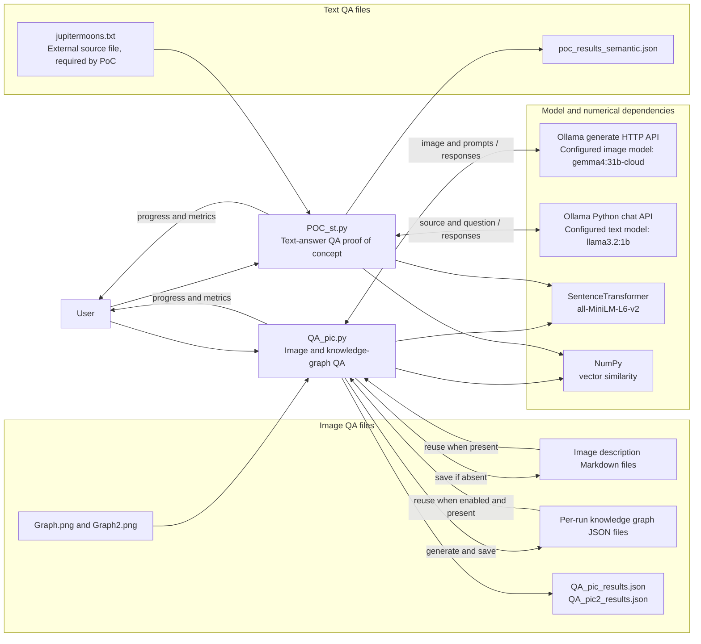
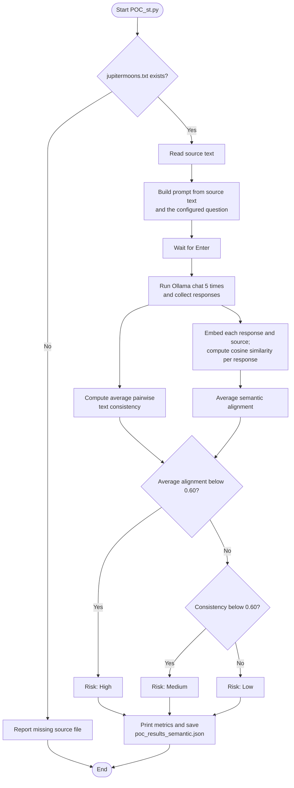

# QA validation of Knowledge Graphs and RAG

This prototype explores quality assurance for model-generated answers and knowledge graphs. One script evaluates repeated answers to a question against a supplied source text. The other evaluates JSON nodes and relationships generated from a knowledge graph image against a text description of that image. Both report a risk level based on variation and semantic alignment.

## Table of contents

- [Features](#features)
- [Tech stack](#tech-stack)
- [Test results and deep project knowledge](#test-results-and-deep-project-knowledge)
- [Diagrams](#diagrams)
  - [Project architecture](#project-architecture)
  - [Text QA workflow](#text-qa-workflow)
  - [Image QA workflow](#image-qa-workflow)
- [How to use](#how-to-use)
  - [Text QA](#text-qa)
  - [Image and graph QA](#image-and-graph-qa)
- [Local setup](#local-setup)
- [Reflection Report](#reflection-report)
- [Credits](#credits)

## Features

- Run a source-grounded question repeatedly and measure answer consistency and semantic alignment.
- Generate image descriptions and structured knowledge graph JSON for two example images.
- Validate graph layers, nodes, edges and edge references, then compare graph-derived sentences with the image, via the image description.
- Report Low, Medium or High risk and save results as JSON, together with the statistics of the runs.

## Tech stack

- Python, version 3.14.6, with [Ollama](https://ollama.com/) for model inference: its Python client for text and HTTP API for images.
- [Sentence Transformers](https://www.sbert.net/) and the `all-MiniLM-L6-v2` embedding model for semantic similarity.
- NumPy for vector operations and Requests for the image script's HTTP calls.

## Test results and deep project knowledge

Supporting test documentation, rules, printouts and scope are collected in the [`docs/`](docs/) folder. Example inputs are in the project root.

- [QA graph to JSON](docs/QA_graph_to_JSON.pdf?raw=1): a project-created Volvo truck spare-part knowledge graph, its generated description, a JSON representation and a test printout. The test description is on the last page.
- Error example: [graph image](docs/Graph_error.jpeg) and [screen output](docs/Screen_output_error.txt). Adding an arrow to the image confused JSON creation, and the QA script flagged High risk. 
- [QA rule pack](docs/QA%20Rule%20Pack.md).
- [Semantic closeness check explained](docs/Semenatic%20closeness%20check%20explained.md).
- [Result-based actions](docs/Result-based%20actions.md).
- [Project scope](docs/Scope%20QA-project.pdf?raw=1).

Example results in short, using a cloud model:

| Result | Valid runs / repeats | Consistency | Semantic alignment | Risk |
| --- | --- | --- | --- | --- |
| [Text QA] | 5 repeats | 0.731 | 0.678 average | Low |
| [Image 1 QA] | 5 / 5 | 0.630 | 0 low-alignment sentences | Low |
| [Image 2 QA] | 5 / 5 | 0.869 | 0 low-alignment sentences | Low |

## Diagrams

The original Mermaid sources are [project architecture](Project_Architecture.mmd), [text QA workflow](Text_QA_Workflow.mmd) and [image QA workflow](Image_QA_Workflow.mmd).

### Project architecture



### Text QA workflow



### Image QA workflow

```mermaid
flowchart TD
    start(["Start QA_pic.py"]) --> nextTest["For each configured image:<br/>wait for Enter"]
    nextTest --> exists{"Image file exists?"}
    exists -- "No" --> skip["Skip this image"]
    skip --> moreTests{"More images?"}
    exists -- "Yes" --> encode["Read image and base64-encode it"]
    encode --> hasDescription{"Description file exists?"}
    hasDescription -- "Yes" --> readDescription["Read existing description"]
    hasDescription -- "No" --> describe["Ask Ollama for a description<br/>and save the Markdown file"]
    readDescription --> beginRuns["Repeat up to 5 graph runs"]
    describe --> beginRuns

    beginRuns --> reuse{"Reuse enabled and<br/>graph file exists?"}
    reuse -- "Yes" --> load["Load graph JSON"]
    reuse -- "No" --> generate["Ask Ollama for graph JSON"]
    load --> validJSON{"JSON parsed?"}
    validJSON -- "No" --> generate
    validJSON -- "Yes" --> validate["Validate layers, nodes,<br/>edges and references"]
    generate --> parse{"Model response parses as JSON?"}
    parse -- "No" --> failedRun["Report failed run"]
    parse -- "Yes" --> saveGraph["Save per-run graph JSON"]
    saveGraph --> validate
    validate --> validGraph{"Structure valid?"}
    validGraph -- "No" --> failedRun
    validGraph -- "Yes" --> sentences["Convert graph nodes and edges<br/>into sentences"]
    sentences --> anySentences{"Sentences produced?"}
    anySentences -- "No" --> failedRun
    anySentences -- "Yes" --> chunks["Chunk the image description<br/>by heading and word limit"]
    chunks --> embeddings["Embed chunks and graph sentences"]
    embeddings --> alignment["For each sentence, take its<br/>best chunk cosine similarity"]
    alignment --> record["Record sentence scores and<br/>mean alignment for this run"]
    record --> moreRuns{"More runs?"}
    failedRun --> moreRuns
    moreRuns -- "Yes" --> reuse
    moreRuns -- "No" --> validRuns{"Any valid runs?"}
    validRuns -- "No" --> noResults["Report that there is nothing to evaluate"]
    noResults --> moreTests
    validRuns -- "Yes" --> consistency["Compute pairwise text consistency<br/>across sorted run sentences"]
    consistency --> low{"Any sentence below<br/>alignment threshold?"}
    low -- "Yes" --> high["Risk: High"]
    low -- "No" --> unstable{"Consistency below 0.60?"}
    unstable -- "Yes" --> medium["Risk: Medium"]
    unstable -- "No" --> lowRisk["Risk: Low"]
    high --> output["Print metrics and save results JSON"]
    medium --> output
    lowRisk --> output
    output --> moreTests
    moreTests -- "Yes" --> nextTest
    moreTests -- "No" --> done(["End"])

    threshold["Default fast chunk mode uses alignment threshold 0.186.<br/>Line-based mode uses 0.5.<br/>One valid run gets consistency 1.0, which is not meaningful."]
    alignment -.- threshold
```



## How to use

Complete the local setup below, then run commands from the project root. Both scripts resolve file paths relative to the current working directory and prompt you to press Enter before continuing after the initial loading.

### Text QA

1. Use `jupitermoons.txt` file in the project root containing the source text. Alternatively, change `SOURCE_FILE` and `QUESTION` in [POC_st.py](POC_st.py) to match your own source and question.
2. Ensure Ollama is running and the configured text model is available.
3. Run:

   ```powershell
   python POC_st.py
   ```

The script asks the same question five times by default, prints the responses and metrics, and overwrites `poc_results_semantic.json`. With the default thresholds, average semantic alignment below 0.60 is High risk; otherwise, consistency below 0.60 is Medium risk; otherwise, risk is Low.

### Image and graph QA

1. The two example images, descriptions and per-run graph files are already in the project root. Configure the image paths, layers, model and other settings in [QA_pic.py](QA_pic.py) if needed.
2. Run:

   ```powershell
   python QA_pic.py
   ```

The script processes both images, validates each graph and writes `QA_pic_results.json` and `QA_pic2_results.json`, overwriting previous results. It reuses existing descriptions automatically and, by default, existing per-run graph files. To generate new graphs, set `REUSE_GRAPH_FILES = False`; this overwrites the corresponding graph files. To generate a fresh description, move or rename the existing description file first. Generation requires a running Ollama service and an available vision model.

With the default fast chunk mode (FAST_CHUNK_TEXT_MODE = True), each description section is grouped into chunks of up to 200 words, with the section heading included in each chunk. Long sections are split at word boundaries, so a chunk may span multiple lines or sentences. This usually produces fewer, larger chunks. If fast chunk mode is disabled, each non-empty line becomes its own chunk, again with the section heading; long lines are not split by the word limit.

Each sentence is compared with its best-matching description chunk. A score below 0.186 in fast mode—or below 0.5 when fast mode is disabled—produces High risk. Otherwise, consistency below 0.60 produces Medium risk, and the rest are Low risk. Invalid graph runs are excluded; if there are no valid runs, no result is saved. A consistency score from only one valid run is not meaningful. Calibrate thresholds for your own data.

## Local setup

1. Install [Ollama](https://ollama.com/download).
2. Install [Python](https://www.python.org/downloads/).
3. From the project root, it's recommended to create and activate a virtual environment in PowerShell (however, this step can be skipped if you want to install packages globally or use another environment):

   ```powershell
   python -m venv .venv
   .\.venv\Scripts\Activate.ps1
   ```

4. Install the dependencies used by both scripts:

   ```powershell
   python -m pip install sentence-transformers numpy ollama requests
   ```

5. Start Ollama if it is not already running, and make the a local text model available if you want:

   ```powershell
   ollama pull local_model_name
   ```
   Then change `MODEL` (in POC_st.py)

   However, the scripts defaults to model `gemma4:31b-cloud`, for both text (POC_st.py) and images (QA_pic.py). To generate descriptions or graphs from images, configure an available Ollama vision model in `MODEL` (in QA_pic.py); the default cloud model also requires suitable Ollama cloud access and a network connection. 

The first use of `all-MiniLM-L6-v2` may download model files, so an internet connection may be needed even when reusing image outputs.

## Reflection Report

The core project idea was to develop quality assurance rules. To exercise those rules in a practical setting, Python tools were created to test text-based retrieval-augmented generation (RAG) and image-derived knowledge graphs. The image workflow also produces a text description of the image, so an image to text tool was indirectly created too.

The biggest takeaway with the project is the QA Rule Pack which sets a framework to do quality assurance. The most important principles are grounding, consistency and a clear structure.

**Recommendation for further development:** test with real images and graphs rather than only project-created examples, and integrate with in-house models.

## Credits

- Developer: Johan Granvinge
- Project idea: Ortelius
- Support: GitHub Copilot
